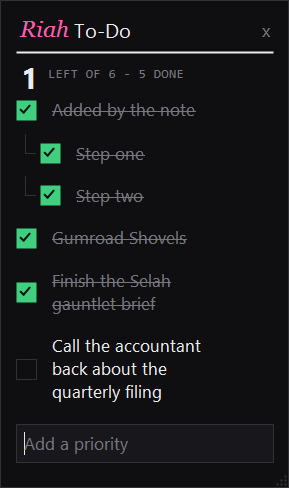

# Riah To-Do

Today's list, by the Windows clock. Click the tray icon and it opens. Click the
box to tick something off, click the words to fix them, click anywhere else and
it's gone. Drag it where you want it. Nothing to leave open, no window to hunt
for.

<p align="center">
  
</p>

The list is **one JSON file**. The note reads and writes it directly, so nothing
else has to be running — no server, no background service, no account.

## Start it

Double-click **`Start Riah To-Do.bat`**. That's the whole install.

- **`Stop Riah To-Do.bat`** — closes the note and the board.
- **`Restart Riah To-Do.bat`** — after changing the tray script.
- **`Open The Board.bat`** — the full page, for when a note isn't enough.

To have it there every morning, put a shortcut to `Start Riah To-Do.bat` in
`shell:startup`.

Needs Windows and PowerShell 5.1, which ships with Windows. Node 18+ is only for
the board page and the AI tools — the note itself needs neither.

## Using it

| You do | It does |
| --- | --- |
| Click the tray icon | The note opens |
| Click the box | Ticks it off — or un-ticks it |
| Click the words | Edits them, right there. Enter saves, Esc cancels |
| Right-click a row | The same thing — straight into editing |
| Drag a row up or down | Reorders it |
| Hover a task, click `+` | Starts a subtask under it |
| Type at the bottom, Enter | Adds an item |
| Hover a row, click the `x` | Removes it |
| Drag the note | Moves it. Drag an edge or corner to resize |
| Click anywhere else | Closes it (Esc and the `x` too) |
| Right-click the tray icon | The list, the board, settings, file the finished ones, quit |

Hovering the icon does **nothing**. It is click-to-open on purpose.

The note remembers where you put it and how big you made it. The first time, it
opens in the top-right corner of whichever screen holds the tray icon.

The icon is the status: one bar per item, green once ticked, and a single green
check when the list is clear.

## Subtasks

A task can hold steps, threaded under it like replies. Hover a task, click the
`+`, type. Nesting stops at one level on purpose — a to-do list that needs a tree
is a project, and this is not a project tool.

Ticking a task ticks its whole thread. Ticking the last open step finishes the
task; reopening any step reopens it. A task is never filed while one of its steps
is still open, and deleting a task takes its steps with it.

Twelve tasks, twelve steps each, 120 characters a line. All deliberate: a list you
can't read at a glance isn't a list of priorities.

## Filing, and the trail it leaves

**Ticked items leave the list two hours later** — by default. They aren't
deleted: they go into `today-filed.json` beside the list. The note is for what's
left, not a monument to what's done. Unfinished items carry over to tomorrow.

Right-click the tray icon → **Settings** to change that:

- **File ticked items after** — straight away, 15 minutes, up to 8 hours, or
  never (clear them yourself from the tray menu).
- **Also write them into a vault** — point it at an Obsidian vault, or any
  folder. Each filing appends to one dated markdown file, with steps indented
  under their task:

  ```markdown
  # Done - 2026-07-28

  - [x] 09:05 Ship the launch
    - [x] 09:06 Write the email
  ```

  Leave it blank and no trail is written. The JSON archive happens either way.

## Where the list lives

```
%APPDATA%\Riah To-Do\today.json          the list
%APPDATA%\Riah To-Do\today-filed.json    what has been ticked off
%APPDATA%\Riah To-Do\settings.json       filing window and vault path
```

Point somewhere else with `RIAH_TODO_FILE` or `RIAH_TODO_DIR` — a synced folder
works fine.

Every write is temp-file-then-rename, so a reader always gets a whole list, never
half of one. Anything else watching the file picks up changes within a couple of
seconds.

## The board

`Open The Board.bat`, or `npm start` then <http://127.0.0.1:8779>. The same list
with more room: drag to reorder, click a label to rename, `+` for a subtask,
light/dark toggle, and the settings above. Optional — the note never needs it.

## Letting an AI set your list

`bin/todo-mcp-server.mjs` is an [MCP](https://modelcontextprotocol.io) server with
five tools: `get_priorities`, `replace_priorities`, `add_priority`,
`set_priority_completed`, `remove_priority`. Point any MCP client at it:

```bash
node bin/todo-mcp-server.mjs
```

It writes the same file, so "make today about the launch" lands on the note a
second later. Run `npm install` first — the tools are the only part with
dependencies.

## Checking it still works

```bash
npm test
```

```bash
npm run smoke:note
```

`npm test` covers the list rules: carry-over, the filing window, threading,
cascading ticks, duplicates, the twelve cap, torn files, the vault trail.

`smoke:note` starts the real tray twice. The first pass drives an add, a tick, two
subtasks and a drag through the same code a click calls, then reads the file back
to prove the PowerShell and Node halves agree on the format. The second pass turns
the filing window down to nothing and checks the vault trail actually appears. It
also saves a picture of the note, so the look can be checked without anyone
driving the mouse.

## Files

```
lib/store.mjs        the list: rules, atomic writes, the sweep. Owner of the format.
tray/…tray.ps1       the note by the clock (PowerShell 5.1, ASCII-only)
server.mjs           the board's local server
index.html           the board
bin/…mcp-server.mjs  the tools an AI uses
test/                the rules suite, and the real-tray smoke
scratch/tray.log     what the note did, and when. Read this first if it misbehaves.
```

## Fitting it into something else

Anything that can read and write JSON can join in — the file is the API. Riah
Code, the desktop app this was carved out of, keeps its own priorities panel and
simply reads and writes the same file, which is why the two never disagree.

MIT licensed. The fonts in `assets/fonts/` are SIL OFL; their licences ship
beside them.
