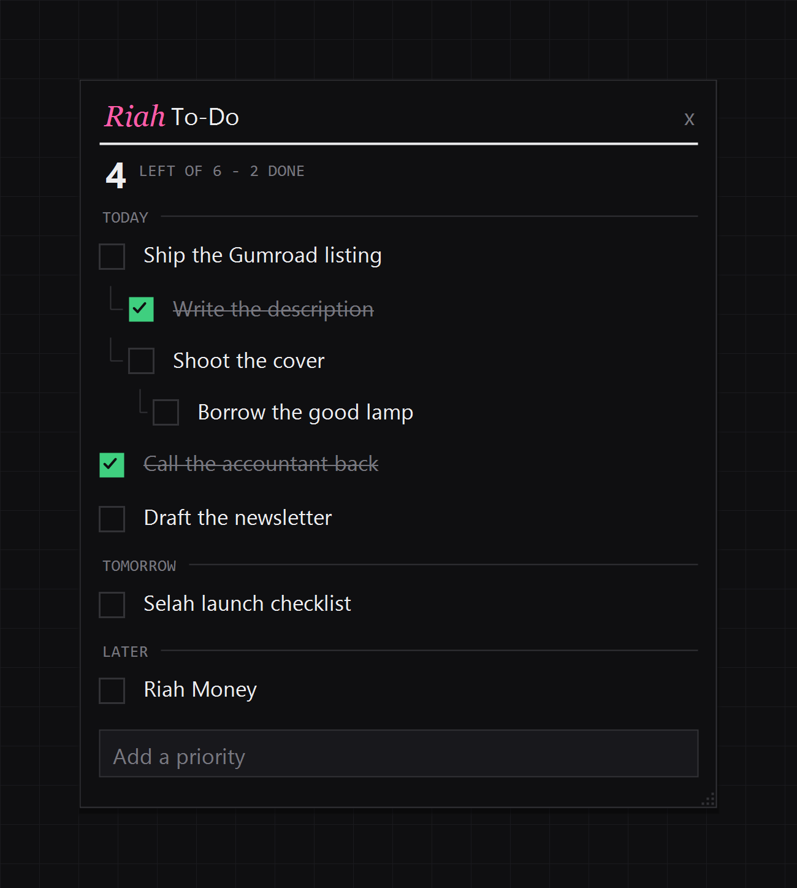
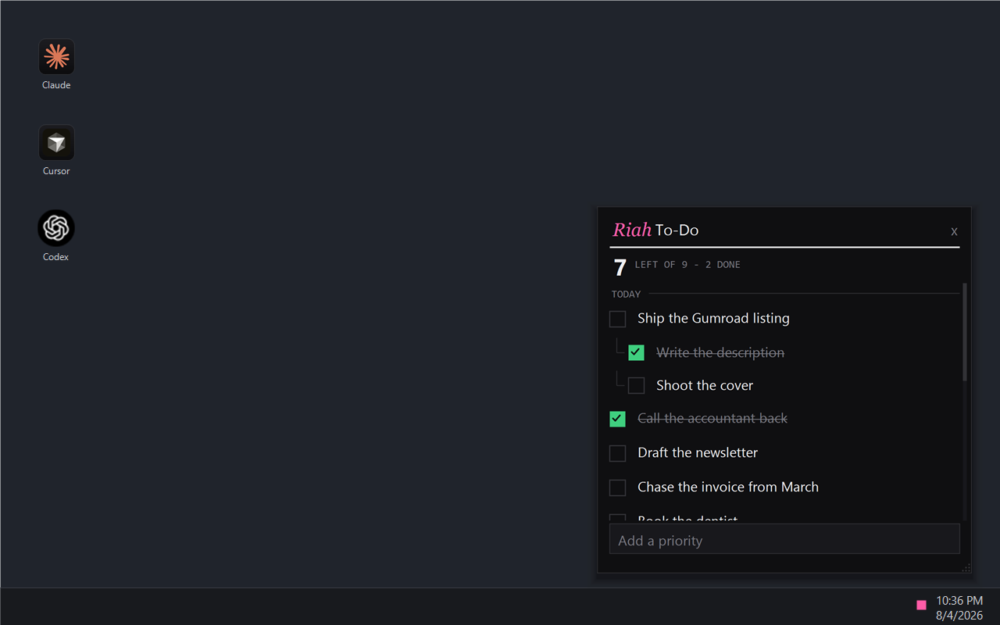

# Riah To-Do

## Direct answer

**Riah To-Do** is a free to-do list that lives where you already look. On Windows it opens as a note beside the clock. On a Mac it opens as the same-looking page in your browser. Click, write today's list, click away. Data stays in one local JSON file with optional Obsidian filing. Limitations: no cloud sync or accounts; the Windows note does not need Node, but the Mac/board page does.


<p align="center">
  
  
</p>

**The to-do list you'll actually open.**

On Windows it sits by the clock. On a Mac it is a page that looks the same. Write today's list, click away.

We all want to be organized. We've all downloaded twenty different to-do apps to prove it. And most of us never opened one of them twice. Not because we stopped caring, but because opening it was a chore.

This one lives where you already look. Checked-off tasks clear themselves, and land in your Obsidian vault (adjustable, of course). It's one small JSON file on your own PC.

**Free, and running in about a minute.**

## Quick start

**Windows 10 or 11**

1. Download the latest ZIP from [Releases](https://github.com/RiahStudio/riah-todo/releases), or use **Code → Download ZIP**.
2. Extract it somewhere you'll keep it — `Documents\Riah To-Do` is fine.
3. Double-click **`Start Riah To-Do.bat`**.

An icon appears by the clock. Click it. (Windows 11 may hide new icons in the chevron — drag it onto the taskbar once.)

To stop later: **`Stop Riah To-Do.bat`**. For every morning: put a shortcut to `Start Riah To-Do.bat` in `shell:startup`.

**Mac**

1. Same ZIP, extract it somewhere you'll keep it.
2. Install [Node.js 18+](https://nodejs.org) if you don't have it.
3. In Terminal: `chmod +x start.sh && ./start.sh`

The board opens in your browser. Same list, same type.

## Requirements

- **Windows** 10 or 11 — PowerShell 5.1 ships with Windows; nothing else to install for the note
- **macOS** — Node.js 18+ (the board is the app; there is no menu-bar note)
- **Node.js** 18+ is also optional on Windows, for the board page and the AI tools

No accounts with us. No sync. No telemetry.

## System tray (Windows)

Click the tray icon to open the note. **Hover does nothing** — click-to-open on purpose. Click away (or Esc / the `x`) and it closes.

- Drag the note to move it; drag an edge or corner to resize
- Drag the top or bottom edge to lock a height — then the list scrolls inside
- Right-click the tray icon for the list, the board, what you've finished, settings, file the finished ones, quit

The icon is the status: one bar per item, green once ticked, and a single green check when the list is clear.

## Using it

| You do | It does |
| --- | --- |
| Click the tray icon | The note opens |
| Click the box | Ticks it off — or un-ticks it |
| Click the words | Edits them in place. Enter saves, Esc cancels |
| Right-click a row | Same — straight into editing |
| Shift + right-click a task | Moves it Today → Tomorrow → Later → Today |
| Drag a row | Reorders among its siblings |
| Hover a row, click `+` | Starts a subtask (up to six levels) |
| Hover a row, click `z` | Sleeps it — off the list, not done. Click `N SLEEPING` to see them; **WAKE** puts one back; **BACK TO LIST** returns |
| Type at the bottom, Enter | Adds an item |
| Hover a row, click the `x` | Removes it |

Ticking a task ticks its whole thread. Unfinished work carries over tomorrow. Checked-off tasks leave the list after two hours by default (adjustable) and can also land in an Obsidian vault — right-click the tray → **Settings**.

## The board

On a Mac this *is* the app (`./start.sh`). On Windows it's optional extra room: **`Open The Board.bat`**, or `npm start` then <http://127.0.0.1:8779>. Same list, more space, keyboard-friendly. Prefer the board if you use a screen reader — the Windows note is painted, not real controls.

## Privacy

- One JSON file on your own machine (`%APPDATA%\Riah To-Do\` on Windows, `~/Library/Application Support/Riah To-Do` on a Mac)
- Nothing leaves your machine
- No accounts, no sync, no telemetry

Point somewhere else with `RIAH_TODO_FILE` or `RIAH_TODO_DIR` — a synced folder works fine.

## Letting an AI set your list

```bash
npm install
node bin/todo-mcp-server.mjs
```

Five MCP tools write the same file, so the note updates a second later.

## Checking it still works

```bash
npm test
```

`npm run smoke:note` needs a real Windows desktop (see `RELEASE-CHECKLIST.md`).

## From the maker

This is a vibe-coded project — I'm not a real developer and probably won't become one. It's just something cool I wanted for myself, to make my life easier, so I made it. I would love feedback if it's not too technical or aggressive 😅.
Hope you guys like it!

## License

MIT — free to use, fork, and ship. Keep the license file. Bundled fonts are under the SIL Open Font License (see `assets/fonts/`).

Something wrong? Open an issue and attach `scratch/tray.log` from the app folder if you can.
